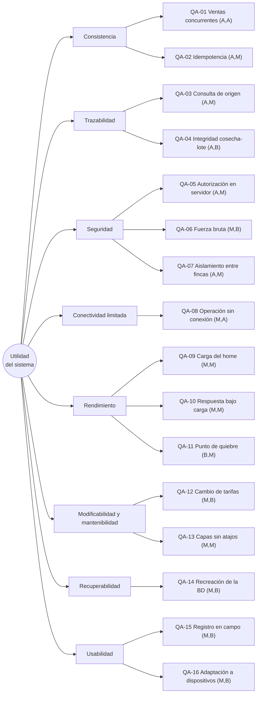

# 02 · Árbol de utilidad

Cada hoja lleva **(importancia para el negocio, dificultad técnica)** con A = alta, M = media, B = baja. La propuesta inicial viene del prompt maestro (sección 17.2). Aquí cada valor tiene una razón escrita; el equipo debe leerla y corregirla si no la comparte.

Imagen: [diagramas/arbol-utilidad.svg](diagramas/arbol-utilidad.svg) (fuente Mermaid: [arbol-utilidad.mmd](diagramas/arbol-utilidad.mmd)).

## Valores y justificación

| Escenario | (Imp., Dif.) | Por qué importancia | Por qué dificultad |
|---|---|---|---|
| QA-01 Ventas concurrentes | (A, A) | Es el driver D1 literal. Un saldo negativo invalida el inventario y las ventas. | Hay que coordinar escrituras simultáneas sobre la misma fila sin perder rendimiento. Es la única hoja (A, A) y la que más condiciona la estructura. |
| QA-02 Idempotencia | (A, M) | Con red inestable (C-02) un reintento duplicaría ventas o pagos. | Es una clave única más la devolución del resultado original. Cuesta menos que la concurrencia, pero tiene casos límite (reintento mientras la primera aún corre). |
| QA-03 Consulta de origen | (A, M) | Es D2: sin trazabilidad no hay auditoría de calidad ni de origen. | Es una consulta recursiva sobre movimientos con volumen alto; necesita índices bien elegidos. |
| QA-04 Integridad cosecha-lote | (A, B) | Una cosecha sin lote rompe D2. | Se resuelve con NOT NULL, clave foránea y clave compuesta (finca, lote). Es barato y se hace de entrada. |
| QA-05 Autorización en servidor | (A, M) | Es D3. Un permiso solo visual no protege nada. | Hay que cubrir cada Server Action y Route Handler sin atajos; la dificultad está en la disciplina y en probarlo con una batería. |
| QA-06 Fuerza bruta | (M, B) | Riesgo real, pero acotado a un vector de ataque. | Contador de intentos y bloqueo temporal; técnica conocida. |
| QA-07 Aislamiento entre fincas | (A, M) | Una fuga entre fincas es una violación de D3 y de C-01. | Todas las consultas deben filtrar por organización y finca; se garantiza con repositorios que lo exigen y con una batería de pruebas. |
| QA-08 Operación sin conexión | (M, A) | Es la restricción C-02, pero solo afecta a las cosechas; el resto exige conexión. | Es la hoja más difícil después de QA-01: cola local, reintentos, duplicados, conflictos y estado visible. |
| QA-09 Carga del home | (M, M) | Es la primera impresión, pero no pone en riesgo datos. | Depende del peso de imágenes y del carrusel; se controla con presupuesto. |
| QA-10 Respuesta bajo carga | (M, M) | Importa en temporada de cosecha. | El límite real es el pool de conexiones de Render Free. |
| QA-11 Punto de quiebre | (B, M) | Es información para la pregunta "si el negocio crece diez veces", no un requisito funcional. | Requiere pruebas de estrés y análisis. |
| QA-12 Cambio de tarifas | (M, B) | Evita errores comerciales y de liquidación. | Versionado con vigencias y una restricción de no solapamiento. |
| QA-13 Capas sin atajos | (M, M) | Es la evidencia del criterio 4 de la rúbrica. | Reglas de dependencias en CI; el esfuerzo está en mantenerlas verdes. |
| QA-14 Recreación de la BD | (M, B) | Render Free expira y se reinicia (C-04). | Migraciones, semillas y `pg_dump`; trabajo repetible. |
| QA-15 Registro en campo | (M, B) | Es la tarea más frecuente del recolector. | Formulario corto de pocos pasos. |
| QA-16 Adaptación a dispositivos | (M, B) | En campo se usa el celular. | Diseño mobile-first con pruebas de desborde. |

## Cómo discrimina el árbol

- **(A, A): 1 hoja** (QA-01). Se diseña, implementa y prueba primero, y justifica el estilo (ADR-001) y el control de concurrencia (ADR-002).
- **(A, M): 4 hojas** (QA-02, QA-03, QA-05, QA-07). Van en el núcleo del Bloque C y D.
- **(A, B): 1 hoja** (QA-04). Barata y obligatoria: se hace desde la primera migración.
- **(M, A): 1 hoja** (QA-08). Dificultad alta con importancia media: se implementa solo para cosechas y se documenta su límite (ADR-003).
- **(M, M) / (M, B): 8 hojas.** Se cumplen con técnicas estándar y no mueven la estructura.
- **(B, M): 1 hoja** (QA-11). Se mide y se reporta; no se construye nada especial para ella.

Los escenarios del Entregable 1 que se redactan completos son QA-01, QA-03 y QA-05, uno por cada driver original (ver [03-escenarios.md](03-escenarios.md)).
