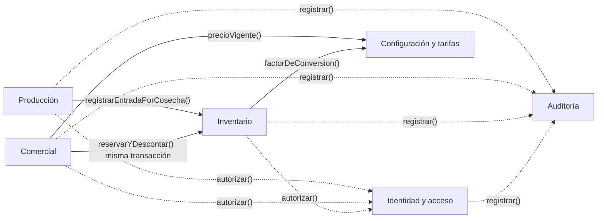

# 05 · Contextos delimitados

Cada contexto es un módulo en `src/modules/<contexto>/{domain,application,infrastructure}`. Una frontera se justifica con al menos una **señal**: vocabulario distinto, ciclo de vida distinto, responsable distinto o regla de consistencia propia.

## 1. Núcleo

| Contexto | Qué contiene | Señal que justifica la frontera |
|---|---|---|
| **Identidad y acceso** | Organizaciones, usuarios, roles, permisos, sesiones, intentos de acceso. | *Responsable distinto* (el administrador) y *vocabulario propio* (rol, permiso, sesión). Ciclo de vida independiente de la producción. Es la base de D3. |
| **Producción** | Fincas, lotes, cultivos, temporadas, cosechas. | *Responsable distinto* (encargado de producción) y *vocabulario propio* (lote, cosecha, variedad). *Regla de consistencia propia*: toda cosecha tiene un lote de la misma finca (D2). |
| **Inventario** | Productos de inventario, bodegas, movimientos, saldos, transformaciones. | *Regla de consistencia propia y la más fuerte*: existencias nunca negativas y movimientos inmutables (D1). *Vocabulario propio* (saldo, movimiento, reverso). |
| **Comercial** | Clientes, productos comerciales y precios, pedidos, ventas, pagos de clientes. | *Responsable distinto* (responsable comercial) y *ciclo de vida distinto* (pedido, venta, cobro). Vocabulario propio (cartera, comprobante). |
| **Configuración y tarifas** | Unidades, equivalencias, tarifas versionadas, parámetros. | *Ciclo de vida distinto* (cambia por decisión del administrador, con vigencia) y *regla propia*: las vigencias de una misma tarifa no se solapan. |
| **Auditoría** | Registro append-only de operaciones sensibles. | *Regla propia*: solo se inserta, nunca se modifica ni se borra. Transversal: los demás contextos la usan, ella no depende de ninguno. |

## 2. Extensiones (se construyen solo si el núcleo está probado)

| Contexto | Qué contiene | Señal |
|---|---|---|
| **Talento y remuneraciones** | Trabajadores, vinculaciones, asignaciones, registros de producción por trabajador, liquidaciones, anticipos. | Responsable distinto (financiero) y datos personales que exigen tratamiento propio (C-01). |
| **Beneficio y poscosecha** | Etapas, flujos por tipo de producto, entradas y salidas por etapa. | Vocabulario propio (despulpado, lavado, secado). Alimenta transformaciones de Inventario. |
| **Compras y finanzas** | Proveedores, compras, gastos, cuentas por pagar y por cobrar. | Los movimientos financieros son distintos de los físicos (sección 11 del prompt). |
| **Sanidad y planificación agrícola** | Inspecciones, aplicaciones, planes de actividades. | Ciclo de vida y vocabulario propios (broca, floración). |
| **Maquinaria** | Equipos, mantenimientos, usos. | Responsable y vocabulario propios. |

## 3. Mapa de relaciones

Reglas del mapa:

1. **Un contexto solo habla con otro a través de su capa de aplicación.** No se leen ni escriben las tablas de otro contexto directamente.
2. **Comercial → Inventario es una llamada síncrona dentro de la misma transacción.** Es la única forma de cumplir D1: la venta y el descuento comparten una unidad de trabajo que la capa de aplicación abre y pasa a ambos módulos. Es un acoplamiento intencional y aceptado (ver ADR-001 y ADR-002).
3. **Producción → Inventario:** registrar una cosecha crea su movimiento de entrada, en la misma transacción.
4. **Todos usan Identidad y acceso para autorizar** y **Auditoría para dejar rastro**. Identidad y Auditoría no dependen de los demás.
5. **No hay dependencias circulares.** Lo verifica dependency-cruiser.

## 4. Glosario mínimo (identificadores en español, sin tildes)

| Término de dominio | Identificador | Significado |
|---|---|---|
| Organización | `organizacion` | Cliente del sistema; agrupa fincas y usuarios. |
| Finca | `finca` | Unidad productiva de una organización. |
| Lote | `lote` | Parcela de cultivo dentro de una finca. |
| Cosecha | `cosecha` | Recolección registrada: lote, fecha, cantidad, unidad. |
| Movimiento | `movimiento_inventario` | Hecho inmutable que cambia las existencias. |
| Saldo | `saldo_inventario` | Proyección de existencias por producto, lote y bodega. |
| Transformación | `transformacion` | Paso que convierte un producto en otro (cereza → pergamino → excelso). |
| Venta | `venta` | Operación comercial con detalle por lote de origen. |
| Tarifa | `tarifa` | Valor con vigencia; versionado. |
