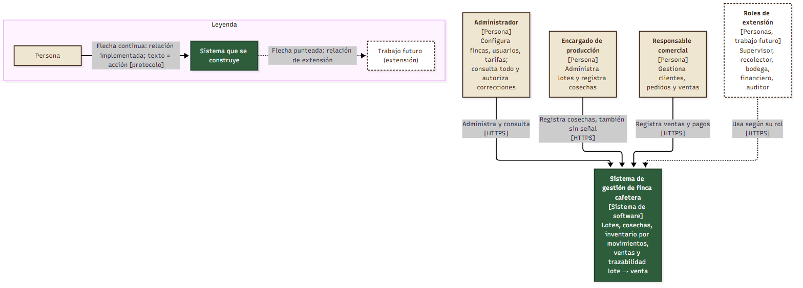
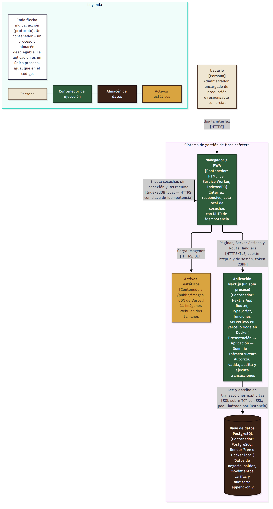

# 07 · Diagramas C4 (niveles 1 y 2)

Herramienta: **Mermaid** (reproducible; el código vive en `diagramas/*.mmd`). Las imágenes se exportan con `npm run docs:diagramas` (mermaid-cli) a `diagramas/*.svg` y `diagramas/*.png`.

## Nivel 1 · Contexto

Fuente: [c4-nivel-1-contexto.mmd](diagramas/c4-nivel-1-contexto.mmd)

| Elemento | Propósito | Tecnología / protocolo |
|---|---|---|
| Administrador | Configura fincas, usuarios, tarifas y parámetros; consulta todo; autoriza correcciones | Navegador, HTTPS |
| Encargado de producción | Administra lotes y registra cosechas, incluso sin señal | Navegador móvil, HTTPS |
| Responsable comercial | Gestiona clientes, pedidos, ventas y pagos | Navegador, HTTPS |
| Roles de extensión | Supervisor, recolector, bodega, financiero, auditor (trabajo futuro) | Navegador, HTTPS |
| Sistema de gestión de finca cafetera | Un solo sistema que cubre lotes, cosechas, inventario, ventas y trazabilidad | Ver nivel 2 |

El sistema no tiene integraciones externas: no se conecta a facturación electrónica ni a pasarelas de pago.

## Nivel 2 · Contenedores

Fuente: [c4-nivel-2-contenedores.mmd](diagramas/c4-nivel-2-contenedores.mmd)

| Contenedor | Propósito | Tecnología | Dónde corre |
|---|---|---|---|
| Navegador / PWA | Interfaz; cola local de cosechas con UUID de idempotencia; indicador de sincronización | HTML, TypeScript, Service Worker, IndexedDB | Dispositivo del usuario |
| Activos estáticos | Imágenes optimizadas de la plataforma | WebP en `/public/images`, CDN de Vercel | Vercel |
| Aplicación Next.js | **Un solo proceso**: presentación, aplicación, dominio e infraestructura | Next.js (App Router), TypeScript strict | Vercel (serverless) o Docker (local) |
| Base de datos PostgreSQL | Datos de negocio, saldos, movimientos, tarifas y auditoría | PostgreSQL | Render Free o Docker (local) |

| Relación | Protocolo y detalles |
|---|---|
| Usuario → Navegador | Interacción en pantalla |
| Navegador → Activos estáticos | HTTPS GET |
| Navegador → Aplicación | HTTPS/TLS; cookie de sesión httpOnly, Secure y SameSite; protección CSRF en mutaciones; Server Actions y Route Handlers |
| Navegador → Navegador (cola local) | IndexedDB; al volver la red se reenvía con la clave de idempotencia |
| Aplicación → PostgreSQL | SQL sobre TCP con SSL obligatorio; transacciones explícitas; pool limitado por instancia |

## Coherencia con el código

- El diagrama muestra **una** aplicación: el repositorio tiene **un** proceso de aplicación (`src/app` y `src/modules`). Si algún día se añade otro proceso, este diagrama debe cambiar antes.
- Las capas internas de la aplicación (nivel 3) se describen en [04-estilo-arquitectonico.md](04-estilo-arquitectonico.md) y se verifican con dependency-cruiser en CI.
- En local, `docker compose up` levanta dos contenedores (aplicación y PostgreSQL), con la misma estructura que este diagrama.

## Leyenda

Aparece dentro de cada imagen. Resumen: figura beige = persona; verde = contenedor de ejecución; marrón oscuro = almacén de datos; dorado = activos estáticos; borde punteado = trabajo futuro. Cada flecha lleva la acción y el protocolo entre corchetes.
