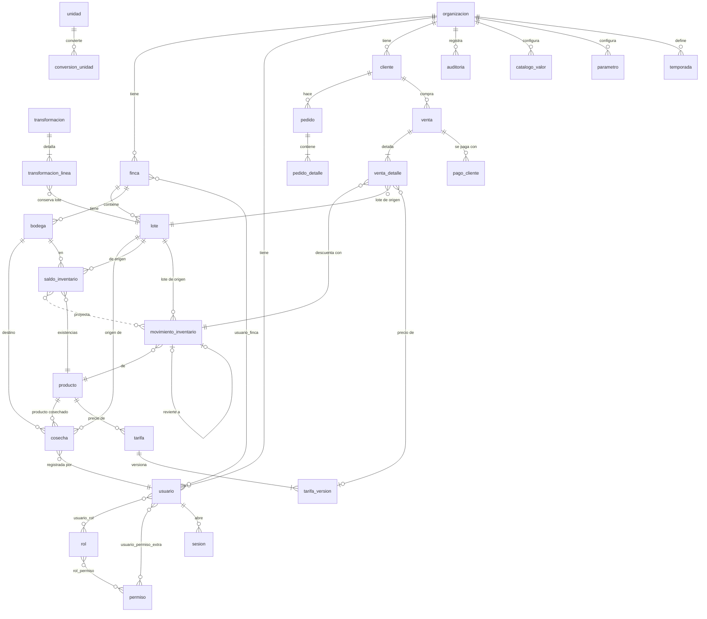

# Modelo entidad-relación

Estado de cada entidad: **Implementada** (existe en una migración y se usa) o **Diseñada** (solo en este diagrama). A 2026-11-11 **todas las entidades de las tablas de abajo están implementadas** (migraciones 0001 a 0007); lo que sigue "Diseñado" sin tabla se indica expresamente.

## Núcleo (implementado: migraciones 0001 y 0002)

Cardinalidades clave: una cosecha pertenece a **un** lote (obligatorio); un movimiento de inventario pertenece a **un** lote de origen; un detalle de venta enlaza **un** movimiento y **un** lote; un movimiento solo puede tener **un** reverso.

## Cadena de trazabilidad (D2)

`lote` → `cosecha` (entrada al inventario) → `transformacion_linea` (conserva el lote) → `saldo_inventario` / `movimiento_inventario` (por producto y lote) → `venta_detalle` (lote de origen y movimiento) → `venta`.

La trazabilidad es **por lote**: de una venta se llega al lote de cultivo y a las cosechas de ese lote registradas hasta la fecha de la venta. No se vincula cada kilo vendido a una cosecha individual. Es una decisión consciente de alcance, documentada como limitación.

## Entidades de extensión (diseñadas; se migran cuando se construye su módulo)

| Módulo | Entidades | Estado |
|---|---|---|
| Talento y remuneraciones | trabajador, vinculacion, asignacion, registro_produccion, liquidacion, liquidacion_detalle, anticipo, pago_trabajador | Implementada (0003; `asignacion` se resolvió con `registro_trabajo.lote_id`) |
| Beneficio y poscosecha | proceso_tipo, proceso_etapa, proceso_registro | Implementada (0004; `proceso_tipo`, `proceso_etapa`, `proceso_registro`) |
| Compras y finanzas | proveedor, compra, compra_detalle, gasto, cuenta_por_pagar | Implementada (0005; `cuenta_por_pagar` se deriva de `compra`) |
| Sanidad | inspeccion, aplicacion_agroquimica | Implementada (0006; más `agroquimico`, `agroquimico_stock`, `agroquimico_movimiento`, `registro_ambiental`) |
| Planificación agrícola | actividad_programada | Implementada (0006; más `proyeccion_cosecha`) |
| Maquinaria | equipo, mantenimiento | Implementada (0006; más `uso_equipo`) |

## Decisiones de normalización y fusiones

- **3FN** en todo el núcleo. Desnormalizaciones justificadas:
  - `venta_detalle.precio_unitario` guarda el precio **aplicado** además de `tarifa_version_id`, porque una venta histórica no debe cambiar si se edita una tarifa.
  - `cosecha.cantidad_base` y `factor_aplicado` guardan la conversión usada; la equivalencia puede cambiar después.
  - `saldo_inventario` es una proyección de `movimiento_inventario` (se actualiza en la misma transacción) para no sumar todos los movimientos en cada venta.
- **Fusiones para no crear tablas por acumulación:** `catalogo_valor` agrupa listas configurables (métodos de pago, tipos de gasto, tipos de café, estados); `parametro` guarda parámetros operativos por organización o finca; un solo `producto` sirve a inventario y a comercial.
- **Claves compuestas** `(lote_id, finca_id)` y `(bodega_id, finca_id)` hacen imposible que una cosecha, un movimiento o una venta mezcle un lote o bodega de otra finca (QA-04, QA-07).

## Estrategia de auditoría

Tabla `auditoria` de solo inserción (un trigger rechaza `UPDATE` y `DELETE`). Cada operación sensible (venta, cambio de tarifa, ajuste, inicio de sesión fallido, permiso denegado) guarda usuario, acción, entidad, id, resultado (`ok`, `denegado`, `error`), valores antes y después (sin contraseñas ni datos personales innecesarios) e IP. Los movimientos de inventario y las versiones de tarifa también son inmutables (triggers).

Lo que **no** es configurable: existencias ≥ 0, cosecha con lote de su finca, movimientos inmutables, auditoría append-only.
